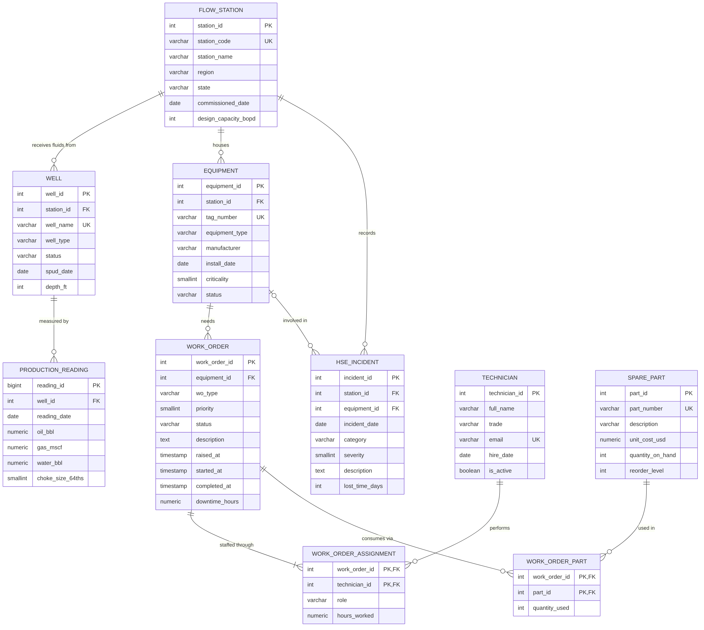

# Portfolio 1: Database Design and Modelling

**Case study:** Niger Delta Flow Systems Ltd (fictional). See [CASE_STUDY.md](CASE_STUDY.md).
**DBMS:** PostgreSQL 16.

## Design process (stages from Session 1)
1. **Requirements:** record production per well per day, maintain equipment, raise and staff work orders, track spare-part stock, log HSE incidents, report by station.
2. **Conceptual design:** entities and relationships in [`er_diagram.mmd`](er_diagram.mmd) (rendered: [`er_diagram.png`](er_diagram.png)).
3. **Logical design:** 10 tables in third normal form, see [NORMALISATION.md](NORMALISATION.md).
4. **Physical design:** data types, keys and constraints in `01_schema.sql`. Performance indexes are added later in Portfolio 2.
5. **Implementation:** `00` to `02` scripts.
6. **Testing:** `03_constraint_tests.sql` proves the constraints reject invalid data.



## Relationships
| Relationship | Cardinality | Implemented by |
|---|---|---|
| flow_station - well | 1 : N | `well.station_id` FK |
| flow_station - equipment | 1 : N | `equipment.station_id` FK |
| well - production_reading | 1 : N | `production_reading.well_id` FK, `UNIQUE (well_id, reading_date)` |
| equipment - work_order | 1 : N | `work_order.equipment_id` FK |
| work_order - technician | M : N | junction `work_order_assignment` (composite PK) |
| work_order - spare_part | M : N | junction `work_order_part` (composite PK) |
| flow_station - hse_incident | 1 : N | `hse_incident.station_id` FK |
| equipment - hse_incident | 1 : N, optional | nullable `hse_incident.equipment_id` FK |

## Keys and constraints summary
- **Primary keys:** surrogate integer keys on every entity; composite primary keys on the two junction tables.
- **Foreign keys:** `ON DELETE RESTRICT` for history-bearing parents (cannot delete a station that still has wells), `CASCADE` from work order to its assignment and part rows, `SET NULL` for the optional incident-equipment link.
- **Unique:** `station_code`, `well_name`, `tag_number`, `part_number`, `technician.email`, `(well_id, reading_date)`.
- **Check:** allowed values (`well_type`, `status`, `region`, ...), non-negative volumes and stock, priority and severity ranges, `completed_at >= raised_at`, and `COMPLETED` orders must have a completion time.
- **Not null / defaults:** required facts are `NOT NULL`; sensible defaults such as `status = 'OPEN'`.

## Run order
```
psql -U postgres -f 00_create_database.sql
psql -U postgres -d ndfs_db -f 01_schema.sql
psql -U postgres -d ndfs_db -f 02_sample_data.sql
psql -U postgres -d ndfs_db -f 03_constraint_tests.sql      (all 8 statements must fail: that is the pass condition)
```
Useful checks for your screenshots: `\dt`, `\d work_order`, `SELECT count(*) FROM well;`.

## Evidence to capture (put in `evidence/`)
1. `\dt` listing the 10 tables. 2. `\d work_order` showing keys and constraints. 3. Row counts after loading.
4. The eight error messages from `03_constraint_tests.sql`. 5. The ER diagram (also in pgAdmin: right-click the database, ERD For Database).
