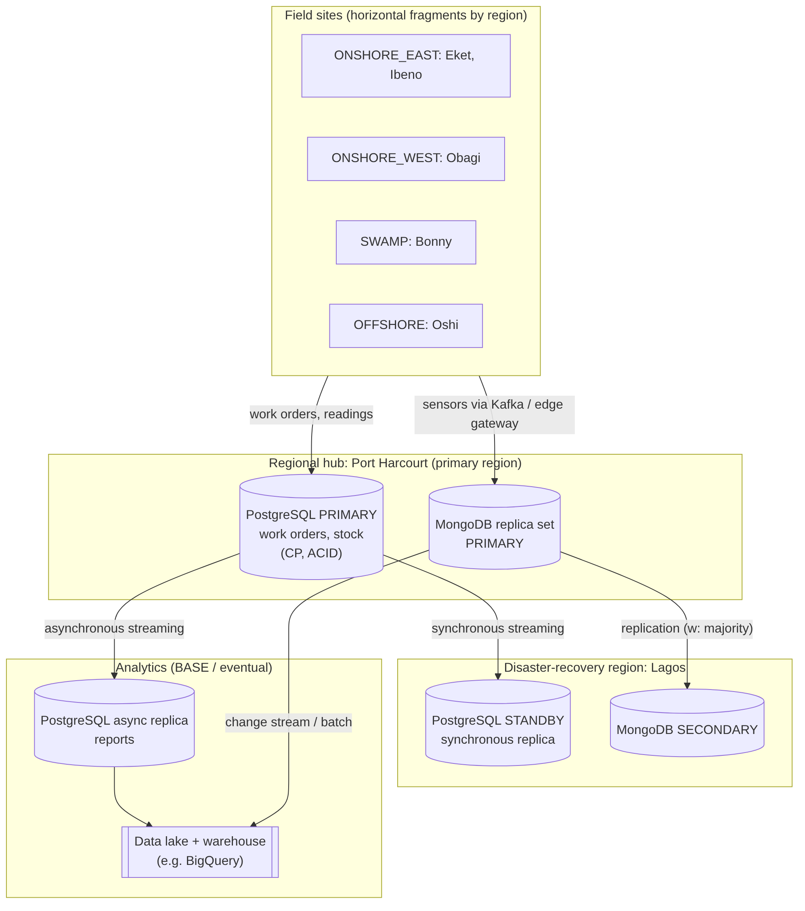

# Portfolio 5: Distributed and Cloud Database Exercise

**Case study:** NDFS (fictional Niger Delta upstream operator). Stations are spread across four regions
(`ONSHORE_EAST`, `ONSHORE_WEST`, `SWAMP`, `OFFSHORE`). Remote and offshore sites suffer slow, unreliable links, while
maintenance and stock decisions need correct, up-to-date data. The design below applies the Session 2 and Session 3 concepts
(fragmentation, replication, CAP, ACID/BASE hybrid, cloud platforms, security) to that problem.

## 1. Problem statement
1. One central database is a **single point of failure**: if it is down, no station can raise or close work orders.
2. **High latency and unreliable links** from swamp and offshore sites to a distant data centre.
3. **Growth**: telemetry and production history grow continuously.
4. **Different data, different needs**: stock levels must never be wrong; a dashboard can be a few seconds stale.

## 2. Fragmentation (partitioning) design
| Data | Strategy | Key | Reason |
|---|---|---|---|
| `production_reading`, `work_order`, `hse_incident` | **Horizontal** fragmentation by region | `flow_station.region` | Sites mostly read/write their own region's data; keeps queries local |
| `flow_station`, `spare_part` catalogue, `technician` | **Replicated** everywhere (small, read-mostly reference data) | none | Avoids cross-region joins |
| Sensitive HSE narrative and personnel details | **Vertical** fragmentation: split from operational columns | `incident_id` / `technician_id` | Different access policy; can be hosted in a restricted store |
| `sensor_telemetry` (MongoDB) | **Sharded** by `{meta.tag, ts}` | see `03_sharding_reference.js` | Spreads writes across machines; queries target one tag + time window |

PostgreSQL can implement the horizontal split with declarative partitioning
(`PARTITION BY LIST (region)`) on one server, or with separate regional servers combined by foreign data wrappers
(a *federated* design). MongoDB provides sharding and zone sharding directly.

## 3. Replication design
| System | Topology | Mode | Purpose |
|---|---|---|---|
| PostgreSQL (work orders, stock) | primary + standby in a second region | **synchronous** streaming replication | No committed work order is lost on failover (RPO ~ 0), at the price of slightly higher commit latency |
| PostgreSQL reporting replica | primary -> read replica | **asynchronous** | Heavy reports off the primary; small lag acceptable |
| MongoDB | 3-node replica set across two regions | `w: "majority"` for critical writes, `w: 1` for telemetry | Automatic election of a new primary when one fails |

Failover behaviour to explain: in a MongoDB replica set the secondaries elect a new primary (typically within seconds).
Writes acknowledged by a majority survive the election. With `w: 1`, a write not yet copied could be rolled back,
which is acceptable for a telemetry sample but not for a closed work order.

## 4. CAP and the hybrid ACID/BASE model
During a network **partition** between regions a system must choose between consistency and availability.

| Workload | Choice | Mechanism | Example behaviour in a partition |
|---|---|---|---|
| Work-order closure, spare-part stock, HSE incident register | **CP / ACID** | PostgreSQL primary, synchronous standby, majority writes | The isolated minority side refuses writes rather than risk two versions of stock |
| Telemetry, dashboards, notifications | **AP / BASE** | MongoDB time-series, `w:1`, secondary reads, asynchronous replicas | Sites keep recording; data converges after reconnection |

This mirrors the lecturer's GlobalCare case: strong consistency for patient treatment and billing (Spanner) and
BASE for social features (Cassandra/DynamoDB). It also answers the discussion point "ACID *and* BASE, not one or the other".

## 5. Cloud deployment
| Component | Cloud option | Evidence in this repo |
|---|---|---|
| MongoDB | **MongoDB Atlas** (free M0: a managed 3-node replica set) | `01_replica_set_status.js`, `02_write_concern_and_read_preference.js` output, Atlas dashboard screenshots |
| PostgreSQL | Managed service (AWS RDS for PostgreSQL / Cloud SQL / Supabase free tier) | optional: screenshot of the managed instance and `\conninfo` |
| Analytics | Data lake for raw telemetry, warehouse (e.g. BigQuery) for reporting | design only |
| Streaming | Kafka between field gateways and the database | design only |

Cloud benefits used in the argument (Session 3): elastic scaling, automated backups, multi-region availability,
pay-as-you-go cost. Cloud risks: connectivity from offshore sites (mitigated by **edge gateways** that buffer data
locally and forward when the link returns), vendor lock-in, and data-residency obligations.

**Security design:** encryption in transit (TLS) and at rest; authentication plus role-based access control
(technicians read/update work orders, store officers modify stock, HSE officers see incident narratives, analysts get read-only
access to replicas); IP allow-listing / private networking; audit logging.

## 6. Scalability and consistency summary (seven-criteria framework)
| Criterion | Decision |
|---|---|
| Scalability | Shard telemetry; add read replicas for reporting; partition production history by region/time |
| Consistency vs availability | CP for stock and work orders, AP for telemetry |
| Query performance | Regional locality, replicated reference data, time-window queries targeted by shard key |
| Schema flexibility | Document store for varying equipment specifications |
| Transactions | Multi-row ACID in PostgreSQL only; no distributed (two-phase commit) transaction across regions is needed |
| Security | RBAC, TLS, encryption at rest, auditing |
| Operational overhead | Managed services; monitoring of replication lag and failover |

## 7. Trade-offs and limits (be ready to defend)
- **Synchronous replication** across distant regions adds commit latency; choose a nearby standby for the synchronous copy and a far one asynchronously.
- **A fully federated design** would give each region autonomy but makes cross-region reporting and consistent stock management hard;
  hence the hybrid: regional fragments plus a central CP core.
- **Sharding is design evidence only** unless you run a sharded cluster; free Atlas tiers do not shard. Say so explicitly in your write-up.
- **Possible improvement (edge/IoT):** process telemetry at an edge gateway, forward only aggregates and alarms.

## 8. Files and evidence checklist
| File | Evidence you should capture |
|---|---|
| `architecture.png` / `architecture.mmd` | Included in your summary |
| `01_replica_set_status.js` | Output showing the set name, PRIMARY and members (Atlas or local compose) |
| `02_write_concern_and_read_preference.js` | Output of the majority write, the `w:1` write and the secondary read |
| `docker-compose.yml` (optional) | `rs.status()` before and after `docker stop mongo1` (failover) |
| `03_sharding_reference.js` | Not run; cite as a design reference |
| Atlas console | Screenshot of the cluster page showing the 3 nodes / region |
